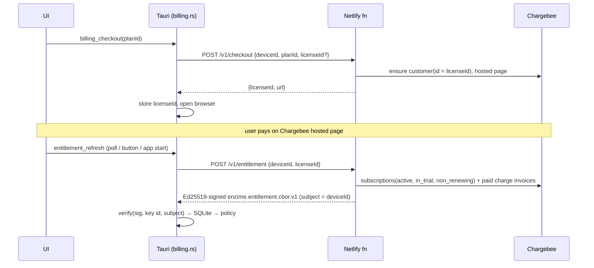

# Billing and analytics

Status: implemented 2026-11-04. Amends ARCHITECTURE.md §13.2 (provider) and
records the analytics decision against PRD §8.3.

## Decision summary

1. **Provider: Chargebee now, WooCommerce later.** RevenueCat (§13.2) is
   replaced; the empty `revenuecat-adapter` crate is removed. The provider
   sits behind `BillingProvider` in `services/billing/src/provider.ts`.
2. **Issuer: a free-tier Netlify Function** (`services/billing`) holds the
   provider secret and the Ed25519 entitlement signing key. Hosting stays
   within revenue (Netlify free tier, or shared hosting with Node 22+).
3. **App: offline verification only.** `apps/reader/src-tauri/src/billing.rs`
   verifies artifacts against an embedded public key, stores them in
   `entitlement_artifacts`/`entitlement_grants`/`trust_keys` (§6.2), and feeds
   `OfflineCapabilityPolicy`. The UI receives `CapabilityDecision[]` only
   (§13.5).
4. **Analytics: opt-in GA4 via Measurement Protocol** from the native side,
   with an allow-list that cannot carry content.

## Trust model

- The app holds **no provider secret**. Forging an entitlement requires the
  issuer private key.
- Artifacts are bound to the device id (`subject.subject_id`). A copied
  database on another device fails verification.
- The **license id is a bearer restore key** (≈130 random bits). Anyone with
  it can restore on their own device, the usual license-key trade-off. Abuse
  shows up as many artifacts per customer and can be rate-limited
  server-side later.
- **A-09:** an empty purchase list never deletes stored artifacts. Lifetime
  grants are `perpetual`; subscription grants are `term` and end at the
  paid-through date (trial end while in trial).
- Grace window: `OfflineCapabilityPolicy::DEFAULT_GRACE_WINDOW_MS` (existing
  policy).
- Cross-language byte compatibility (TypeScript CBOR ↔ Rust ciborium) is
  pinned by `crates/entitlement/tests/ts_golden.rs` and the matching
  TypeScript test.

## Capability gating

Feature code uses `useCapability(key)` from `stores/entitlementStore.ts`.
Denied paid actions stay visible and link to *Settings → Plan*; core reading,
highlights, comments, bookmarks and export are never gated (§13.1).

## Analytics

| Rule | Enforcement |
|---|---|
| Off until the user opts in | `settings['analytics.consent']`; first-run banner; Settings → Privacy |
| No content | native allow-list of event names and keys; values must match `[a-z0-9_:/.-]{1,64}` |
| No ids in paths | UI sends route templates (`/reader/:packid/:articlekey`) |
| No identity linkage | random per-install `client_id`, separate from device id and license id |
| No third-party script in the webview | Measurement Protocol from Rust, not gtag.js |

Events: `page_view`, `app_open`, `view_plans`, `select_plan`,
`begin_checkout`, `purchase_refresh`, `restore_purchase`,
`open_billing_portal`, `capability_gate`, `pack_install_start`,
`annotation_create{kind}`, `title_search` (no query text).

## WooCommerce migration path

Implement `BillingProvider` against the ecosystem plugin, swap it into the
function, and repoint `catalog.json` product ids. App releases, the artifact
format, the signing key and existing grants are unchanged.
