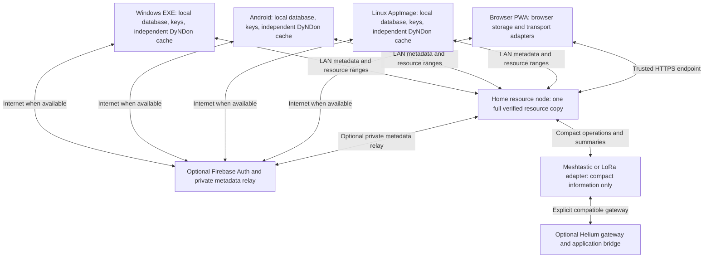

# Proposed EnZIME offline identity, metadata sync, and resource topology

Date: 2026-10-25. Status: DESIGN DRAFT; no implementation or runtime acceptance claimed.

## Scope and authority

The user requested architecture for Firebase user authentication and metadata sync, independent DyNDon selection on devices with different storage budgets, one full home-LAN resource copy, and optional Wi-Fi mesh, Meshtastic/LoRa, and Helium-style connectivity. The user explicitly prohibited building or implementing these features for now. Windows EXE is the present acceptance target for shared application behavior; Android execution is not required for that gate.

This document proposes an additive overlay to `DOCS/ARCHITECTURE.md`; it does not silently rewrite its frozen baseline or amendments. Product intent comes from that architecture, `DOCS/REBOOT-PAK/PRD.md`, the existing `DOCS/TEST_RUBRIC.md`, and the user's current instructions. KStore remains the sole authority for Admin-Manual and reminders. Current KStore `/doc` requests returned 404, reminder/search requests returned 500 or timed out. Consequently current Admin-Manual reconciliation is unresolved; local documents' older Admin-Manual quotations are historical references, not a fresh authority read. This draft must not be called governance-approved or ready for implementation until that reconciliation and user design review are complete.

No application files, Firebase project, server, radio, deployment, or binary were changed by authoring this design.

## Current evidence and gaps

- The October 15 build report identifies source commit `26db277664b402f3922ebdc94491e0aa456e22fa` and application version `1.6.55832`.
- Inspection found no Firebase Auth/Firestore dependencies or initialization in the active app/crates, JS lockfile, Cargo manifests/lockfile, or Android SDK dependency report. Account sync and mesh adapters are proposed, not included features of that APK.
- `crates/dyndon/src/cluster_fit.rs::plan_fit` already selects clusters by domain, breadth, depth, ranking, and `SelectionIntent.budget_bytes`. Its byte ceiling is a payload-planning input; it is not a complete disk-reservation system.
- `ClusterCacheArchive` already distinguishes local clusters from an optional range-transfer source. Production discovery, authenticated LAN serving, persistent peer synchronization, bounded cache policy, and cross-device account ownership require additional architecture/wiring.
- The Tauri shell currently registers 11 commands covering bootstrap/home/readiness, reader open/article, and the M1 library/install flow. Linking a crate into the binary does not establish that all its capabilities are reachable from real UI commands.
- The existing screencast rubric covers DyNDon M1 on Linux AppImage. It is not an all-specifications Windows gauntlet. The companion draft defines the proposed replacement scope without erasing the old evidence.
- No current AppImage is present in `dist/`. An older ZIP is named `web-pwa`, but contains only HTML/CSS/JS; neither it nor the newer frontend output establishes a working installable/offline PWA.

## Approaches and proposed decision

| Approach | Benefit | Limitation against this request |
| --- | --- | --- |
| Firebase-centered metadata | Straightforward internet-connected account synchronization | Firebase caching does not exchange changes between isolated LAN peers; a separate local path remains necessary |
| Pure peer-to-peer | Independent of Firebase availability | Does not by itself provide the requested Firebase identity, remote relay, or account recovery |
| Local-first hybrid | Local use, LAN sharing, optional cloud relay, and constrained-radio adapters share one operation model | More explicit identity, conflict, and replication contracts to implement |

The proposed choice is the local-first hybrid. It is the architect's recommendation, not a claim that the user explicitly selected its implementation details. Other requested delivery platforms remain consumers of the same contracts.

## Topology and ownership

The home node is a preferred resource source and optional metadata relay, not the owner of every device's database. A client remains useful if it cannot reach the node or Firebase. A resource source may advertise availability; only the client's storage policy can allocate or evict its cache. Existing peer-to-peer connections can exchange authorized metadata without the home node. Large content takes an IP path or explicit file transfer.

The diagram represents adapter boundaries, not automatic interoperability between Meshtastic, LoRaWAN, and Helium. Each requires a compatible radio or gateway and a separately implemented bridge.

## What is synchronized

| Data class | Ownership and replication |
| --- | --- |
| Resource identity, version, verified manifest, content digests | Immutable, version-pinned references shared across devices |
| Library selection intent, bookmarks, notes, notebooks, tags, reading history, accepted lore | Private metadata replicated within the user's authorized sync space |
| Suggested storage policy | May be synchronized as a preference; each device explicitly opts into applying it |
| Device free space, local paths, installed/resident clusters, cache quota, reservations, download checkpoints | Local state; optional expiring availability summaries do not become another device's storage authority |
| ZIM bytes, models, images, voice/ink blobs | Separate content-addressed objects; fetch only by explicit policy over suitable transports |
| Firebase credentials, refresh tokens, device private keys | Local protected secrets; never part of synchronization payloads |
| Entitlements | Existing signed-grant verification remains authoritative; a synchronized metadata operation cannot mint a paid capability |

Resource eviction is not a deletion of bookmarks, annotations, or personal work. Deleting a personal note is a distinct replicated operation. Devices show whether an item is available offline, only on the LAN, only remotely, or unavailable.

## Identity and offline authentication

1. Core reading, annotation, search, local export, and local grant verification work in a local profile without a Firebase account, consistent with the existing PRD.
2. A profile has a stable local principal ID. A device has its own signing key and stable device ID derived from its public key. Resource IDs and annotation IDs do not depend on paths, network addresses, or email addresses.
3. Firebase Auth may link that principal to a Firebase UID when online. New Firebase sign-in, account creation, token refresh, and cloud authorization require contact with the relevant backend. A remembered account label is not fresh server authorization.
4. Normal local access uses local profile unlock and local policy. LAN peers use owner-approved, signed device membership/capability records and challenge-response with the device key. They do not accept an expired Firebase ID token as fresh authority.
5. Initial LAN pairing can occur offline: the user confirms a QR code or matching fingerprint on an already trusted device, then that device signs a scoped membership grant. This does not create or impersonate a Firebase account. A later verified online link attaches the cloud account.
6. A grant specifies sync-space ID, device public key, permissions, membership epoch, issuer, and any explicit expiration. Previously paired personal devices may continue their last authorized local permissions while partitioned. Grants never expand permissions without a new owner-authorized record.
7. Revocation cannot be instantaneous on a disconnected device. Reconnection applies the signed membership update and rejects subsequently unauthorized operations according to its recorded epoch. The UI distinguishes local trust from currently verified cloud membership. High-risk account/ownership changes wait for authoritative verification.
8. Shared PCs support separate profiles and clear sign-out/lock behavior. The future test harness must use independent protected profiles; it must not copy one account's tokens or private key into another instance.
9. Private metadata is encrypted for the sync space before leaving the local store. Device signatures authenticate operations; transport encryption and radio-channel membership alone are insufficient. Recovery requires an explicit encrypted backup/recovery-key flow; resetting a Firebase password alone must not promise recovery of end-to-end encryption keys.

### Revocation, key rotation, and partitioned edits

The proposed privacy default is to protect future metadata from a revoked device. The space owner signs a new membership epoch, revokes that device, rotates the space's encryption key, and wraps the new key only for the still-authorized device keys. A non-revoked offline device receives the new key through a trusted peer or an owner-signed key envelope on reconnection. The cloud may relay encrypted key envelopes but cannot authorize a new recipient by itself.

Revocation cannot erase plaintext, old ciphertext, or old keys already retained by the removed device. It prevents access to future key epochs once communicating participants have learned and enforced the revocation. Devices still partitioned with the revoked peer may continue sharing under their old knowledge; no immediate global confidentiality guarantee is claimed.

A signature and claimed epoch do not prove whether an edit occurred before revocation. The owner therefore includes a signed accepted-operation checkpoint in the revocation record: the exact approved history frontier/digests for the removed device, checkpoint revision, and previous-checkpoint hash. Once that record is learned, every replica uses that same boundary, independent of message arrival order. Operations outside it are quarantined even if a partitioned replica previously projected them or they claim an older timestamp/epoch. Previously seen work remains in a visible recovery branch/audit record; it is not silently lost, but it no longer counts as canonically synchronized merely because one replica accepted it first.

Authorized operations that causally depend on an excluded operation are held as part of the same explicit branch conflict, rather than left as an unexplained missing-dependency queue. Unrelated work continues. An owner-signed resolution identifies the branch/digests, chosen disposition, and a common replacement checkpoint. Selected work is imported as new currently authorized operations with preserved provenance; dependent work is explicitly reissued/rebased by an authorized author or owner import, with the old-to-new identity mapping recorded. Original signatures/payloads are not rewritten. Discarded branches stay out of the canonical projection. All replicas converge on the resolution/checkpoint when delivered; they do not claim automatic convergence before that owner decision. Conflicting owner checkpoint chains are a visible trust conflict, not resolved by wall-clock order. W-PAIRING and W-METADATA-SYNC must exercise opposite delivery orders, an authorized dependent edit, recovery, and the eventual common projection.

### Linking a populated device to an existing account

Firebase sign-in identifies the cloud account; it does not by itself grant possession of an existing encrypted space's keys. A new device enrolls in an existing space only with approval/key delivery from a trusted member or the explicit recovery-key flow. If neither is available, it may retain its independent local space or create a separate new space under that account; it must not pretend the inaccessible space was recovered.

When the account has no space, the owner may explicitly bind the current local space after online UID verification. If the account already has one or more spaces, the app preserves the device's existing local work and asks which existing space to enroll in or whether to retain a separate space. Multiple spaces per account are supported. Distinct spaces never silently collapse merely because their devices sign in with the same UID. Rebinding a space to another account is a separate owner-authorized operation, not an automatic sign-in side effect.

Moving local work into another space is an explicit previewed import: show object/asset counts, conflicts and storage impact; preserve source IDs/provenance; deduplicate only when stable identity and content agree; retain divergent objects as a conflict or a newly identified imported object. Publish the imported work as newly authorized operations in the destination space. Do not copy credentials, device identity, installed paths or cache residency. Canceling enrollment/import leaves the original local space and its data intact. W-IDENTITY and W-CLOUD-REJOIN must cover two independently populated devices joining the same account without implicit merge or loss.

Firebase ID tokens currently last approximately one hour. Firebase Auth persistence remembers account state; it is distinct from Firestore data caching. These facts must not become a periodic sign-in requirement for the local reader.

## Firebase's offline limits and the cloud adapter

Firestore can read/query cached data, accept supported local writes, and synchronize those writes when the backend becomes reachable. Android-native persistence is normally enabled by default; web persistence requires explicit setup and browser support. A Tauri WebView is not automatically covered by the native Android SDK guarantee. The application therefore owns a durable local database/outbox instead of delegating its essential offline behavior to a Firebase SDK cache.

The cloud adapter uses Firebase Auth and supported Firestore Core document operations. Enterprise Pipeline operations are not an offline-capable substitute. Edition and SDK choices must be verified before implementation. Transactions requiring server reads are not used to acknowledge an offline user edit.

Cloud storage is a relay of private metadata operations, snapshots, and references, not the sole store of user work or the default repository for large knowledge resources. Firebase security rules restrict an authenticated UID to its own private partition and authorized membership records. A household resource source does not implicitly share one person's notes with every household user. Cross-user sharing requires an explicit separate space/grant.

Clients verify device signatures, schema bounds, scope, and membership before applying relayed operations. Firebase Authentication or a writable cloud document alone does not establish that an operation is valid. Any privileged membership administration requires a trusted backend or owner-signed membership validation; service-account secrets never ship in the EXE/APK/PWA.

The home node may relay an encrypted operation when it later has internet access. The originating device may also upload the same operation. Stable IDs make this idempotent. The UI separately reports saved locally, acknowledged by a LAN peer, and acknowledged by cloud; none is substituted for another.

Firebase's emulator suite is for testing, not a production self-hosted Firebase replacement. LAN operation uses the application's own peer protocol and membership model.

## Durable metadata operation contract

An operation envelope contains: schema version, sync-space ID, object ID/type, device ID, durable per-device sequence, operation ID, causal parents/version information, operation kind, referenced object digests, encrypted bounded payload, key/membership epoch, and signature. Wall-clock timestamps are display information, not the sole conflict-ordering authority.

- A local transaction commits the user change and outbox record together before showing durable success.
- Operation identity is the device identity plus its monotonically increasing durable sequence. Counter rollback is prohibited; recovery enrolls a new device identity if uniqueness cannot be guaranteed.
- Incoming operations pass signature/membership/schema validation, then enter a durable deduplicating inbox. Missing causal dependencies are requested or held; arrivals are not applied in arbitrary network order.
- The local projection, received-operation record, and acknowledgment checkpoint commit atomically. Replay after a crash cannot duplicate an annotation or purchase.
- LAN, cloud, radio, and explicit signed file exchange all carry the same operation identities. A transport cannot invent a different identity for the same edit.
- Bookmarks/tags use explicit add/remove semantics. Concurrent note-body edits preserve both versions and surface a conflict. Reading positions preserve per-device history and a defined selected continuation; they do not blindly choose the largest page number.
- Resource manifests are immutable per version. Concurrent preference changes use a deterministic policy with visible history. Actual residency and eviction remain device-local.
- Deletion propagates a tombstone without the deleted text. Acknowledgment-based compaction retains enough history or a signed snapshot baseline to stop an old offline peer from resurrecting deleted objects. A peer older than the retained baseline must reconcile a snapshot before uploading stale state.
- Deletion of content-bearing history and encryption keys follows an explicit retention/purge policy. The app must not claim that deletion already reached a device that is still offline. Backup retention and any cloud-provider retention are disclosed separately.

## One home resource copy and independent DyNDon

The default home topology stores one full verified copy of each chosen resource version on a PC/NAS. Every device reads the same immutable manifest but computes its own plan. For example, one 90 GB home resource can supply a 4 GB phone cache and a 20 GB laptop cache, while a LAN-connected client can read uncached sections on demand.

This means one full master copy plus optional device subsets. A strict single physical copy with no device caching cannot provide access to those bytes after a client leaves the LAN. The UI must explain this distinction instead of calling a LAN reference offline-installed.

Before passing a budget into the existing planner, a device storage coordinator reserves room for database/index growth, staging/verification, required bootstrap/index structures, and a user-visible safety reserve. The effective new allocation is the non-negative minimum of remaining configured cache allowance and currently available bytes after these reservations. Reservations are rechecked at commit time; low-space failure leaves user work and the last verified active resource intact.

The proposed resource manifest adds verified per-cluster/object digests, version/root identity, offsets and lengths, required directory/index/media dependencies, and source capability information to the existing selection description. A subset is a verified cluster-cache representation, not a claim that arbitrary truncation produces a valid complete ZIM.

The home server offers authenticated manifests and resumable immutable ranges or digest-addressed objects. Clients pin the version and compare digests, reject changed ranges, stage bounded writes, and activate only verified objects. Source address changes do not change resource identity. A client may use a pinned peer or upstream source when the preferred node is absent; private or copyrighted content is shared only under its existing permissions.

The home node's resource deletion is explicit and distinct from a client evicting its own cache. Before deleting the sole full copy, the UI reports affected availability and any lack of another verified source. This is an availability decision, not an automatic consequence of device synchronization.

## Transport capabilities and scheduling

| Transport | Intended payload | Availability model |
| --- | --- | --- |
| Home Ethernet/Wi-Fi/IP mesh | Full resources, verified ranges, metadata, annotation assets | Works without internet while the peers and LAN are reachable |
| Direct IP peer or explicit file/sidecar exchange | Authorized metadata and content within policy | Can bridge periods when the home node is absent |
| Internet/Firebase | Account linking and small private metadata replication | Requires backend reachability; local work queues durably while disconnected |
| Meshtastic/LoRa | Compact availability summaries, acknowledgments, references, and explicitly allowed tiny metadata messages | Requires compatible radios and transport-specific limits; may operate without internet |
| Helium IoT/LoRaWAN bridge | Small application messages via gateway/network-server integration | A separate gateway/routing system; not assumed to be an internet-free peer mesh |

Adapters advertise maximum encoded payload, throughput class, latency, ordering, acknowledgment behavior, bidirectionality, cost/metering, and duty-cycle constraints. A scheduler batches and coalesces superseded summaries, honors airtime/retry limits, and prioritizes small useful control messages. Private payloads remain end-to-end protected through bridges.

Large ZIM files, model weights, images, voice notes, and large operation histories never automatically fall back to LoRa. A message that cannot fit the adapter's bounded supported format waits for a suitable IP/file path. Radio exchange does not claim to provide a complete resource catalog or whole-library metadata sync under arbitrary bandwidth limits.

## Platform seams

Keep domain identities, planner policy, signature/operation validation, and merge behavior independent of transports and UI. Proposed ports are `IdentityProvider`, `DeviceTrustStore`, `MetadataOperationStore`, `MetadataReplica`, `ResourceManifestSource`, `ResourceRangeSource`, `ResourceAvailabilityIndex`, `DeviceStoragePolicy`, and `TransportCapabilities`. Names are proposed boundaries, not already implemented APIs.

Windows EXE, Linux AppImage, and Android use the existing Rust/Tauri platform boundary and isolated local databases/object stores. The browser PWA requires browser storage, worker, crypto, file-permission, and networking adapters. It cannot assume native filesystem paths, UDP/mDNS discovery, raw Bluetooth/serial APIs, or identical quota guarantees. Native discovery may use mDNS; PWA discovery must also support a configured/QR HTTPS URL. The browser path needs a trusted secure origin/certificate and appropriate CORS; bypassing TLS validation is not a design option.

PWA installation, service-worker caching, storage persistence requests, quota/eviction behavior, offline app-shell updates, and update rollback each require separate acceptance. A successful Windows run proves neither PWA installability nor browser networking support. AppImage remains a Linux delivery target; Windows acceptance does not manufacture or validate that artifact.

## Failure behavior

| Condition | Required behavior |
| --- | --- |
| No network, no Firebase | Local cached reading, edits, and export continue; outbox remains durable |
| Internet absent, home LAN present | Trusted peer metadata and resource ranges work without Firebase token refresh |
| Home node absent | Cached content remains readable; missing content is truthfully unavailable or fetched from another authorized source |
| Device budgets differ | Shared intent can converge while installed subsets remain different |
| Duplicate/reordered/replayed delivery | Stable operation IDs and causal validation prevent duplicate application |
| Concurrent edits | Defined merge or explicit conflict; no silent loss of a note |
| Wrong key, corrupt object, untrusted manifest | Reject/quarantine; keep last verified active state |
| Cloud rejects queued operation | Keep local work and show rejection/conflict; do not report cloud sync success |
| Revoked peer remains offline | Other connected peers enforce known revocation; UI does not promise instantaneous global enforcement |
| Only radio remains | Compact allowed information can move; bulk content waits with an honest status |

## Acceptance and handoff

The companion `2026-10-25-windows-screencast-gauntlet-design.md` defines requirement traceability, Windows scenarios, evidence, and verdict rules. Every proposed feature is initially UNIMPLEMENTED/UNPROVEN. It is not passed because it is described here.

Implementation requires a separate approved plan after the user reviews the design and current KStore authority is successfully reconciled. Until then: no dependencies installed, no auth project configured, no server deployed, no code added, no binary rebuilt, and no gauntlet executed.

## Primary technical references

- Firebase offline data: https://firebase.google.com/docs/firestore/manage-data/enable-offline
- Firebase auth persistence: https://firebase.google.com/docs/auth/web/auth-state-persistence
- Firebase session tokens: https://firebase.google.com/docs/auth/admin/manage-sessions
- Firestore transactions: https://firebase.google.com/docs/firestore/manage-data/transactions
- Firebase emulator production limitation: https://firebase.google.com/docs/emulator-suite
- Meshtastic transport overview: https://meshtastic.org/docs/overview/
- Helium LoRaWAN topology: https://docs.helium.com/network-iot/learn/understanding-lorawan/
